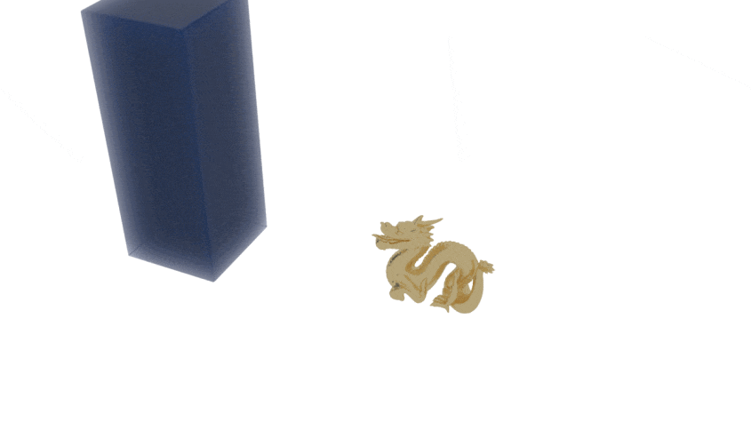
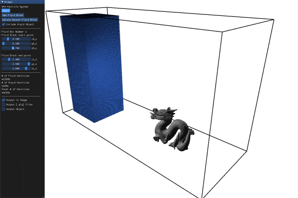
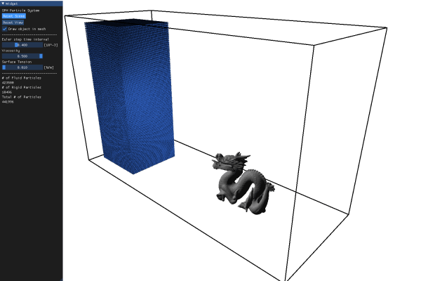
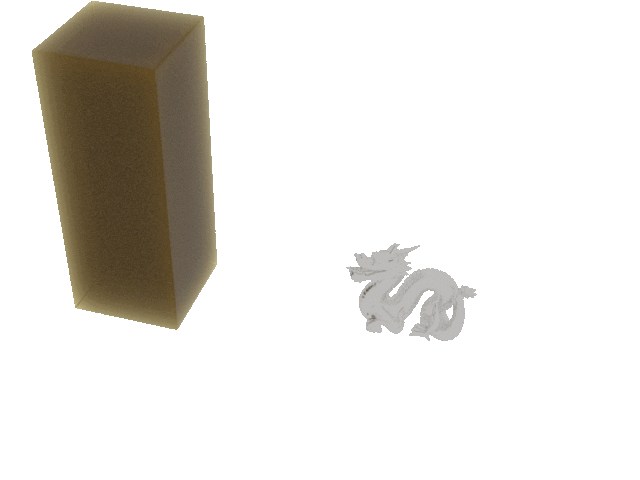
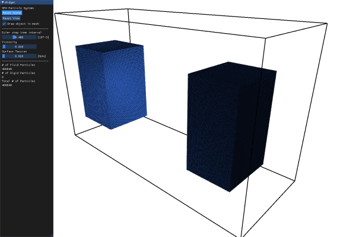
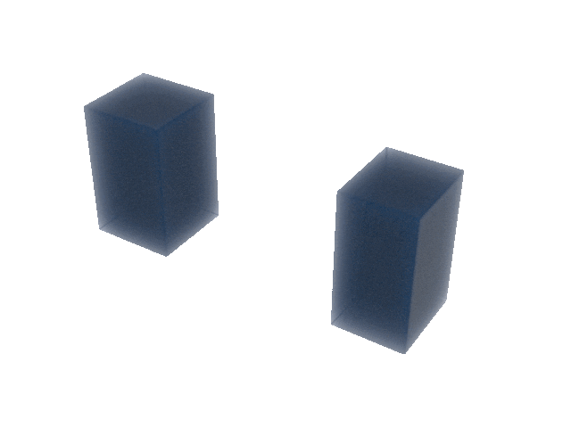
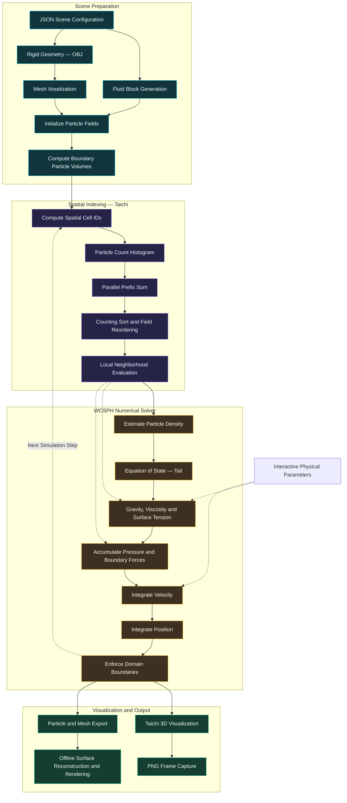
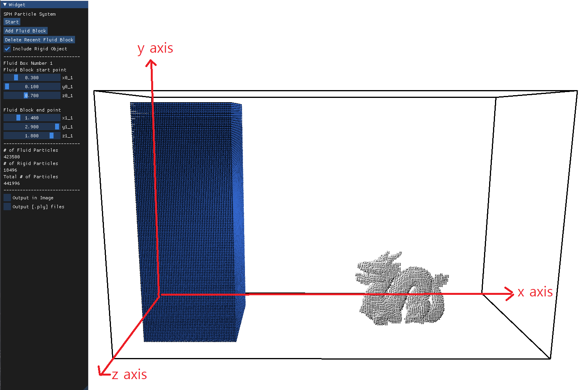
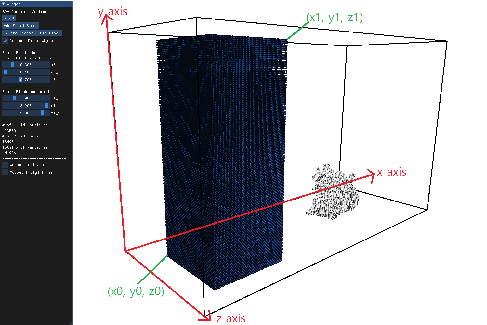
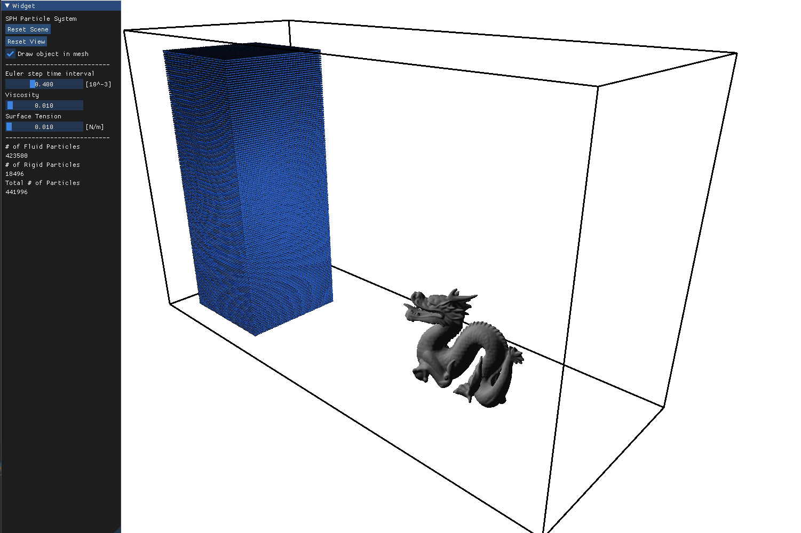

<div align="center">

  <h1>Fluid Engine SPH</h1>

  <p>
    <strong>Exploring fluid motion, one particle at a time.</strong>
  </p>

  <p>
    A GPU-accelerated particle-based fluid simulation exploring
    smoothed particle hydrodynamics, numerical integration,
    spatial computing, and fluid–solid interactions through
    Python and Taichi.
  </p>

  [](https://www.python.org/)
  [](https://www.taichi-lang.org/)
  [](https://numpy.org/)
  [](#numerical-methods)
  [](#simulation-pipeline)

  <p>
    <a href="#overview">Overview</a> ·
    <a href="#simulation-showcase">Showcase</a> ·
    <a href="#mathematical-foundation">Mathematics</a> ·
    <a href="#simulation-pipeline">Pipeline</a> ·
    <a href="#interactive-simulation">Interaction</a> ·
    <a href="#getting-started">Getting Started</a>
  </p>

  

  <sub>
    Particle-based fluid dynamics with offline surface reconstruction
    and rendering in Houdini.
  </sub>

</div>

## Overview

Fluid Engine SPH is a computational simulation project exploring
the behavior of three-dimensional fluids through Smoothed Particle
Hydrodynamics (SPH).

Unlike grid-based fluid simulation methods, SPH represents a fluid
as a collection of moving particles carrying physical quantities
such as position, velocity, mass, density, and pressure.

Physical interactions are approximated through weighted contributions
from neighboring particles, allowing continuous fluid behavior
to emerge from discrete numerical operations.

The simulation uses a Weakly Compressible SPH formulation,
combining pressure forces, viscosity, surface tension, gravity,
and interactions with static rigid geometry.

Built with Python and Taichi, the computational workload is
organized into parallel kernels suitable for GPU execution.

The project explores the intersection of:

- Computational fluid dynamics.
- Particle-based numerical methods.
- Parallel GPU computing.
- Spatial indexing and neighborhood search.
- Computational geometry.
- Fluid–solid interactions.
- Scientific visualization and offline rendering.

## Simulation Showcase

The following scenarios demonstrate how different physical
parameters and initial configurations influence fluid behavior.

Each scenario presents the computational particle simulation
alongside its corresponding offline render.

### Default Configuration

<table>
  <tr>
    <td align="center" width="50%">
      <strong>Particle Simulation</strong>
    </td>
    <td align="center" width="50%">
      <strong>Houdini Render</strong>
    </td>
  </tr>
  <tr>
    <td>
      
    </td>
    <td>
      
    </td>
  </tr>
</table>

A fluid block interacting with the voxelized geometry of a
static dragon sculpture under gravity.

### High Viscosity

<table>
  <tr>
    <td align="center" width="50%">
      <strong>Particle Simulation</strong>
    </td>
    <td align="center" width="50%">
      <strong>Houdini Render</strong>
    </td>
  </tr>
  <tr>
    <td>
      
    </td>
    <td>
      
    </td>
  </tr>
</table>

Increasing the viscosity parameter to `0.5` produces a more
cohesive flow with stronger resistance to relative particle motion.

### Interacting Fluid Blocks

<table>
  <tr>
    <td align="center" width="50%">
      <strong>Particle Simulation</strong>
    </td>
    <td align="center" width="50%">
      <strong>Houdini Render</strong>
    </td>
  </tr>
  <tr>
    <td>
      
    </td>
    <td>
      
    </td>
  </tr>
</table>

Multiple fluid blocks interacting within a shared simulation
domain, demonstrating the collective behavior of particle systems.

The photorealistic examples are offline renders rather than
the native real-time output of the simulation engine.

## Features

| Feature | Description |
| :--- | :--- |
| **Weakly Compressible SPH** | Particle-based approximation of three-dimensional fluid dynamics. |
| **GPU Computing** | Parallel numerical operations through Taichi kernels. |
| **Cubic Spline Kernel** | Compact-support approximation of neighboring particle contributions. |
| **Spatial Indexing** | Uniform spatial grid for local neighborhood evaluation. |
| **Parallel Counting Sort** | Spatial organization of particle data using atomic operations and prefix sums. |
| **Pressure Forces** | Density-dependent pressure calculated through Tait's equation. |
| **Viscosity** | Configurable resistance to relative particle movement. |
| **Surface Tension** | Cohesive interactions between neighboring fluid particles. |
| **Fluid–Solid Interaction** | Coupling between fluid particles and static rigid geometry. |
| **Mesh Voxelization** | Conversion of polygonal meshes into particle-based boundary representations. |
| **Interactive Scene Editor** | Configure fluid volumes and initial scene geometry. |
| **Live Physical Parameters** | Modify viscosity, surface tension, and numerical time step. |
| **Particle Export** | Export fluid positions as PLY sequences. |
| **Geometry Export** | Export rigid geometry in OBJ format. |
| **Frame Capture** | Save rendered simulation frames as PNG images. |

## Mathematical Foundation

Smoothed Particle Hydrodynamics is a mesh-free Lagrangian
numerical method used to approximate the behavior of
continuum media through discrete particles.

Unlike Eulerian methods, where physical quantities are
evaluated at fixed spatial locations, SPH follows particles
as they move throughout the simulation domain.

Each particle carries its own physical state.

| Quantity | Symbol | Description |
| :--- | :---: | :--- |
| Position | $\mathbf{x}_i$ | Current spatial coordinates. |
| Velocity | $\mathbf{v}_i$ | Particle movement vector. |
| Acceleration | $\mathbf{a}_i$ | Rate of change of velocity. |
| Mass | $m_i$ | Particle mass. |
| Density | $\rho_i$ | Local fluid density. |
| Pressure | $p_i$ | Local pressure. |
| Volume | $V_i$ | Particle volume contribution. |
| Support length | $h$ | Maximum kernel interaction distance. |

### SPH interpolation

A continuous scalar quantity can be approximated at a
particle position using weighted contributions from
neighboring particles:

$$
A(\mathbf{x}_i)
\approx
\sum_j
\frac{m_j}{\rho_j}
A_j
W(\|\mathbf{x}_i-\mathbf{x}_j\|,h)
$$

Where $W$ represents a smoothing kernel and $h$
defines its compact support.

This formulation approximates continuous quantities
without requiring a fixed computational mesh.

### Cubic spline kernel

The implementation uses a compact-support cubic spline
kernel to evaluate spatial interactions.

Define the normalized particle separation as:

$$
q=\frac{\|\mathbf{x}_i-\mathbf{x}_j\|}{h}
$$

For three-dimensional simulation, the kernel is:

$$
W(q,h)=
\frac{8}{\pi h^3}
\begin{cases}
1-6q^2+6q^3, & 0\leq q\leq 0.5\\
2(1-q)^3, & 0.5<q\leq1\\
0, & q>1
\end{cases}
$$

Particles outside the support radius contribute nothing
to the local kernel evaluation.

The current implementation defines the support length as:

$$
h=4r
$$

Where $r$ represents the configured particle radius.

### Density estimation

The conventional SPH density approximation is:

$$
\rho_i=
\sum_j m_j W_{ij}
$$

The current implementation additionally accounts for
rigid boundary particles through their estimated volume
contributions.

For the configured equal-mass fluid particles, density
is evaluated using the current particle mass and local
kernel contributions.

This distinction allows fluid behavior near static geometry
to incorporate the surrounding boundary representation.

## Numerical Methods

### Weakly Compressible SPH

The simulation implements WCSPH, a formulation that
approximates incompressible fluid behavior by allowing
limited density variations.

Pressure is calculated using Tait's equation of state:

$$
p_i=
B
\left[
\left(\frac{\rho_i}{\rho_0}\right)^\gamma-1
\right]
$$

Where:

- $\rho_i$ is the estimated particle density.
- $\rho_0$ is the reference fluid density.
- $B$ controls pressure stiffness.
- $\gamma$ controls the equation's nonlinear response.

The implementation clamps density to the reference
density before calculating pressure, preventing negative
pressure values from this equation.

### Pressure acceleration

Pressure interactions between fluid particles are
approximated through the kernel gradient:

$$
\mathbf{a}_i^p=
-\sum_j
m_j
\left(
\frac{p_i}{\rho_i^2}
+
\frac{p_j}{\rho_j^2}
\right)
\nabla_iW_{ij}
$$

Pressure forces oppose excessive compression and help
maintain the fluid's approximate reference density.

Additional boundary terms account for interactions
with rigid particles.

### Viscosity and surface tension

The numerical model includes non-pressure contributions
that influence the behavior of the fluid.

| Contribution | Effect |
| :--- | :--- |
| **Gravity** | External acceleration acting on dynamic particles. |
| **Pressure** | Resistance to local fluid compression. |
| **Viscosity** | Resistance to relative particle motion. |
| **Surface Tension** | Cohesive attraction between neighboring fluid particles. |
| **Boundary Interaction** | Pressure and viscosity contributions from rigid geometry. |

The resulting acceleration is conceptually expressed as:

$$
\mathbf{a}_i=
\mathbf{g}
+
\mathbf{a}_i^p
+
\mathbf{a}_i^\nu
+
\mathbf{a}_i^\sigma
+
\mathbf{a}_i^b
$$

The physical parameters controlling these contributions
can be adjusted through the simulation interface.

### Numerical integration

The solver updates particle velocity before updating
particle position:

$$
\mathbf{v}_i^{n+1}
=
\mathbf{v}_i^n+
\Delta t\,\mathbf{a}_i^n
$$

$$
\mathbf{x}_i^{n+1}
=
\mathbf{x}_i^n+
\Delta t\,\mathbf{v}_i^{n+1}
$$

Although the interface describes this operation as an
Euler step, the update ordering corresponds to
semi-implicit Euler integration.

The integration time step directly influences both
numerical stability and simulation progression.

## Spatial Computing

Evaluating interactions between every possible pair
of particles would introduce quadratic computational
complexity.

For $N$ particles, an exhaustive pairwise comparison
requires up to:

$$
\frac{N(N-1)}{2}
$$

unique particle pairs.

This becomes particularly expensive for simulations
containing hundreds of thousands of particles.

### Uniform spatial grid

The particle system organizes the simulation domain
into a uniform spatial grid.

The grid cell size is equal to the kernel support length:

$$
s_{grid}=h
$$

Particle positions are mapped to spatial cell indices,
allowing neighborhood evaluation to focus on nearby
regions.

In three dimensions, each particle examines candidates
from a neighborhood of up to:

$$
3^3=27
$$

spatial cells.

A distance test then determines whether a candidate
lies inside the particle's kernel support radius.

The grid accelerates neighborhood discovery without
replacing the mesh-free particle formulation of SPH.

### Parallel particle organization

The spatial indexing pipeline uses counting-based
particle organization and prefix sums.

| Stage | Responsibility |
| :--- | :--- |
| Grid Indexing | Map particle positions to spatial cell identifiers. |
| Histogram | Count the number of particles occupying each cell. |
| Prefix Sum | Compute contiguous storage boundaries for spatial cells. |
| Counting Sort | Reorder particle properties according to spatial identifiers. |
| Neighborhood Search | Process particles in nearby cells using the computed offsets. |
| Distance Filtering | Discard candidates outside the kernel support radius. |

Particle properties are reordered together to preserve
the association between position, velocity, pressure,
density, and material information.

The spatial index is rebuilt during each simulation step.

Actual performance depends on particle distribution,
local neighborhood density, GPU memory bandwidth,
and simulation parameters.

## Simulation Pipeline

The simulation separates scene preparation, spatial
organization, numerical force evaluation, particle
integration, visualization, and export.

The following diagram represents the computational
workflow implemented by the current particle system
and WCSPH solver.



The numerical solver operates independently of the offline
rendering workflow.

Taichi provides the interactive particle visualization,
while exported particle sequences can be processed separately
using external graphics applications.

### Core components

| Component | Responsibility |
| :--- | :--- |
| `ParticleSystem` | Particle allocation, spatial indexing, sorting, geometry processing, and data management. |
| `SPHBase` | Smoothing kernels, boundary volumes, integration parameters, and collision constraints. |
| `WCSPHSolver` | Density estimation, pressure computation, physical forces, and numerical integration. |
| `run_simulation.py` | Application lifecycle, interactive scene configuration, rendering, and export. |
| `dragon_bath.json` | Initial geometry, fluid configuration, and numerical parameters. |

## Fluid–Solid Interaction

The simulation supports interactions between fluid particles
and static rigid geometry.

A polygonal mesh is converted into a volumetric particle
representation before numerical computation begins.

<div align="center">

  

  <sub>
    Fluid interaction with a static rigid object represented
    internally through boundary particles.
  </sub>

</div>

### Mesh processing

The rigid geometry preparation process consists of:

1. Load the polygonal mesh using Trimesh.
2. Apply scale, rotation, and translation transformations.
3. Generate a voxel representation of the mesh.
4. Fill its interior to produce boundary particle positions.
5. Initialize rigid particle properties.
6. Estimate particle volume contributions through local kernel evaluation.

The default scene includes a dragon sculpture stored in:

[`data/models/Dragon_50k.obj`](./data/models/Dragon_50k.obj)

Mesh voxelization uses the configured particle diameter
as its spatial pitch.

### Boundary particle volume

Rigid particle volumes are approximated from neighboring
boundary kernel contributions:

$$
V_i=
\frac{1}{
\sum_{j\in\mathcal{B}}W_{ij}
}
$$

Where $\mathcal{B}$ represents the local rigid-particle
neighborhood, including the particle's self-contribution.

These volumes contribute to density estimation and
fluid–boundary force calculations.

### Domain boundaries

The simulation enforces a bounded three-dimensional domain.

Dynamic particles that move outside the permitted spatial
region are repositioned inside the domain, and their
velocity is modified using a configurable collision factor.

The included scene uses a static rigid object. General
six-degree-of-freedom rigid body dynamics are not established
as a supported feature of the current implementation.

## Interactive Simulation

The application provides a two-phase workflow, separating
initial scene preparation from numerical simulation.

### Phase I — Scene Configuration

<div align="center">

  

  <sub>
    Initial particle configuration and interactive scene preparation.
  </sub>

</div>

During the configuration phase, fluid volumes and rigid
geometry can be modified before allocating the complete
simulation state.

| Control | Description |
| :--- | :--- |
| **Start** | Initialize the WCSPH solver and begin simulation. |
| **Add Fluid Block** | Add another particle volume to the scene. |
| **Delete Recent Fluid Block** | Remove the most recently added fluid volume. |
| **Include Rigid Object** | Enable or disable the dragon geometry. |
| **Start Coordinates** | Define the lower coordinate bounds of a fluid block. |
| **End Coordinates** | Define the upper coordinate bounds of a fluid block. |
| **Particle Counters** | Display fluid, rigid, and total particle counts. |
| **Output in Image** | Enable PNG frame export. |
| **Output PLY Files** | Enable particle and rigid geometry export. |

### Spatial configuration

Each fluid block is defined by two three-dimensional
coordinate vectors:

$$
\mathbf{x}_0=(x_0,y_0,z_0)
$$

$$
\mathbf{x}_1=(x_1,y_1,z_1)
$$

Together, these coordinates describe the axis-aligned
volume occupied by its initial particles.

<table>
  <tr>
    <td align="center" width="50%">
      
      <br />
      <sub><strong>Front View</strong></sub>
    </td>
    <td align="center" width="50%">
      
      <br />
      <sub><strong>Fluid Volume Bounds</strong></sub>
    </td>
  </tr>
</table>

### Multiple fluid volumes

<div align="center">

  

  <sub>
    Configuring multiple fluid volumes before numerical simulation.
  </sub>

</div>

Additional fluid blocks are initially duplicated from the
most recently configured block and can subsequently be
repositioned through their spatial coordinates.

> [!WARNING]
> Editing fluid volumes triggers particle field reallocation.
> Continuous slider movement may cause excessive GPU memory
> allocation.
>
> Prefer discrete slider adjustments, keep particle counts
> within available memory, and avoid temporarily expanding
> fluid volumes beyond the intended configuration.

<div align="center">

  

  <sub>Discrete configuration adjustments help limit repeated reallocations.</sub>

</div>

### Phase II — Numerical Simulation

<div align="center">

  

  <sub>
    Numerical fluid simulation with adjustable physical parameters
    and three-dimensional particle visualization.
  </sub>

</div>

After initialization, the solver continuously updates the
particle system according to the configured physical parameters.

| Control | Description |
| :--- | :--- |
| **Reset Scene** | Restore the initial particle configuration. |
| **Reset View** | Restore the default camera position. |
| **Draw Object in Mesh** | Switch between polygonal and particle-based rigid object visualization. |
| **Euler Step Time Interval** | Adjust the numerical integration time step. |
| **Viscosity** | Modify resistance to relative particle movement. |
| **Surface Tension** | Modify cohesive fluid particle interactions. |

The physical parameters can be adjusted while the
simulation is running.

## Simulation Configuration

The default scene is defined in:

[`data/scenes/dragon_bath.json`](./data/scenes/dragon_bath.json)

### Numerical parameters

| Parameter | Default |
| :--- | ---: |
| Simulation Dimensions | 3 |
| Domain Size | 5 × 3 × 2 |
| Particle Radius | 0.01 |
| Particle Diameter | 0.02 |
| Kernel Support Length | 0.04 |
| Reference Density | 1000 |
| Gravity | (0, -9.81, 0) |
| Pressure Stiffness — B | 50000 |
| Pressure Exponent — Gamma | 7 |
| Numerical Sound Speed | 88.5 |
| Integration Time Step | 0.0004 |
| Viscosity | 0.01 |
| Surface Tension | 0.01 |
| Boundary Collision Factor | 0.5 |
| Steps per Render Update | 1 |
| Export Interval | 40 frames |

These are the configured values of the numerical model,
not independently calibrated physical measurements.

### Interactive parameter ranges

| Parameter | Minimum | Maximum |
| :--- | ---: | ---: |
| Integration Time Step | 0.0002 | 0.0008 |
| Viscosity | 0.001 | 0.5 |
| Surface Tension | 0.001 | 5.0 |

The application applies additional time-step limits
when viscosity or surface tension exceeds configured
thresholds.

### Numerical stability

Particle-based fluid simulation is sensitive to the
integration time step and the magnitude of physical forces.

High viscosity, strong surface tension, large particle
counts, or stiff pressure responses may introduce
numerical instability.

The current implementation uses empirical time-step
restrictions for selected parameter combinations.

These restrictions help mitigate instability but do not
constitute a general convergence or stability guarantee.

## Technology Stack

<div align="center">

  

</div>

| Technology | Responsibility |
| :--- | :--- |
| **Python** | Simulation orchestration and application logic. |
| **Taichi** | Parallel numerical computation and GPU kernels. |
| **Taichi GGUI** | Interactive three-dimensional visualization. |
| **NumPy** | Numerical arrays and geometry preparation. |
| **Trimesh** | Mesh transformations and voxelization. |
| **JSON** | Scene configuration and simulation parameters. |
| **PLY** | Exported fluid particle data. |
| **OBJ** | Polygonal geometry representation. |
| **Houdini** | External surface reconstruction and offline rendering. |

## Getting Started

### Requirements

- A Python version compatible with the required Taichi APIs.
- A compatible GPU and graphics driver.
- A graphical desktop environment.
- Taichi.
- NumPy.
- Trimesh.

The project uses Taichi's GPU execution and prefix sum APIs.

### Clone the repository

```bash
git clone https://github.com/4beru/fluid-engine-sph.git

cd fluid-engine-sph
```

### Create a development environment

Create an isolated Python environment:

```bash
python -m venv .venv
```

Activate the environment on Linux or macOS:

```bash
source .venv/bin/activate
```

On Windows:

```powershell
.venv\Scripts\Activate.ps1
```

### Install dependencies

```bash
python -m pip install taichi numpy trimesh
```

> [!NOTE]
> The repository does not currently provide a dependency
> lockfile or pinned package versions.
>
> Compatibility with recent Python and Taichi releases
> may require dependency adjustments.

### Run the simulation

Execute the application from the repository root:

```bash
python run_simulation.py
```

The application opens the scene configuration interface.

Configure the initial fluid volumes and geometry, select
the desired export options, and start the numerical
simulation.

Running from the repository root ensures that scene
configuration and model files are resolved correctly.

### Configure a custom scene

The initial simulation environment can be modified through:

```text
data/scenes/dragon_bath.json
```

The configuration contains three principal sections:

| Section | Purpose |
| :--- | :--- |
| `Configuration` | Domain dimensions and numerical parameters. |
| `RigidBodies` | Geometry, transformations, and material properties. |
| `FluidBlocks` | Initial particle volumes and physical properties. |


---

<div align="center">

  <h3>From particles to possibilities.</h3>

  <p>
    Part of <strong>Computational Simulation</strong> — a collection
    of projects exploring numerical methods, mathematical modeling,
    physical phenomena, and the computational representation
    of dynamic systems.
  </p>

  <p>
    <sub>Curated by Abel Ortega.</sub>
  </p>

  <a href="https://github.com/4beru">GitHub</a> ·
  <a href="https://www.aberu.site">Portfolio</a>

</div>
